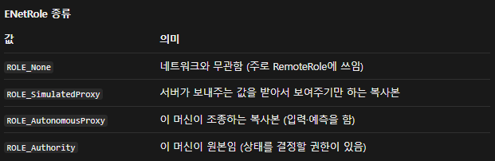

# 서버
게임을 실행하면 프로세스가 하나 생기고, 그 안에 레벨이 로드된 월드가 존재한다. 

서버란 제공자, 클라이언트란 고객, 대상자라는 뜻을 지니고 있다. 서버의 프로세스는 메이플, 리니지와 같은 데이터가 신뢰되어야 하고, 많은 사람들이 접근할 수 있는 경우에는 게임사의 컴퓨터에 생성한다. 리썰 컴퍼니나 협동 게임같은 정보가 변조되더라도 게임에 큰 문제가 없는 경우, 인원이 적은 경우에는 보통 방을 만든 사람의 프로세스를 서버로 사용한다.

이때 게임사가 제공해주는 구조를 데디케이트 서버, 유저의 프로세스를 서버로 사용하는 구조를 리슨 서버라고 한다. Dedicated는 오직 ~만을 위한 이라는 뜻을 가지고 있어서 오직 서버만을 위한 컴퓨터를 배치하기에 데디케이트 서버라고 하고, 리슨 서버는 소켓 프로그래밍에서 서버가 포트를 열고 접속을 기다리는 동작을 `listen()`이라고 하는데, 호스트가 플레이하면서 동시에 다른 사람의 접속을 기다리기 때문에 리슨 서버라고 한다.

두 방식 모두 서버가 게임 상태의 원본을 가지고, 같은 멀티플레이어 세션에 접속한 사용자들의 프로세스를 클라이언트라고 한다.

데디케이트 서버 방식은 플레이어가 없는 서버 전용 프로세스를 만들고 화면을 그리지 않는다. 리슨 서버 방식은 사용자 중 한명의 프로세스를 플레이와 서버 역할을 동시에 하도록 만든다.

# 언리얼 기본

멀티 플레이 게임에서 게임에 영향을 주는 행동은 서버를 원본으로 클라이언트에 복제되어진다. 예를 들어 수집형 게임에서 캐릭터를 뽑을 때 재화의 소비를 클라이언트에서 처리한다면 어떤 방식으로든 변조할 가능성이 존재하지만, 서버에서 검증된 처리를 진행한다면 사전에 방지할 수 있다. 반면에 클라이언트의 화면에만 보여야 하는 연출이나 시각적 처리 등은 서버를 거쳐 클라이언트들에 복제시키도록 하지 않고, 자신에게만 적용시킨다.

언리얼의 레벨에 배치하려면 액터를 상속받아야 한다. 액터는 언리얼의 여러 가지 기본적인 기능들을 상속받고 있고, `ENetRole Role, RemoteRole`을 기본 멤버로 가지고 있다. 이 `ENetRole`은 4가지 상태를 정의한 Enum인데 

이러한 역할을 가지고 있다. 이는 보통 `ROLE_Authority == 현재 상태`를 반환하는 `HasAuthority()`등의 함수를 통해 원본인지 확인해야 하는 경우, 클라이언트에서만 실행되야 하는 경우 등을 체크하기 위해 존재한다.

`Role`(내 머신에서의 역할)과 `RemoteRole`(상대 머신에서의 역할)로 나뉘어지는데, 리플리케이션 될 때 두 값을 뒤바꿔 롤을 정한다.

액터는 스폰한 머신이 소유권을 갖는다. 서버에서 스폰한 경우 서버가 소유권을 갖고, 다른 머신들에 복제시키지만, 클라이언트가 스폰한 경우 클라이언트가 소유권을 갖고 복제되지 않는다. 자신의 화면에서만 재생되어야 하는 이펙트, HUD의 경우 클라에서 스폰하여 사용한다.

예를 들어 내가 적에게 창을 던지는 공격을 한다고 했을 때 조작감을 위해 내가 던지는 동작은 그 즉시 내 화면에 보여져야 한다. 때문에 내 캐릭터는 `ROLE_AutonomousProxy` 상태를 지니며 예측 권한이 부여되어 서버에게 검증받기 전에 먼저 움직인다(검증실패 시 서버 위치로 보정되어진다). 적의 캐릭터는 내가 조종하지 않는 액터이기에 서버가 보내주는 상태를 받아와 보여줘야 한다. 때문에 `ROLE_SimulatedProxy` 상태를 지닌다. 

이때 내가 던지는 창은 누군가 조작하는 게 아닌 나와 적이 동시에 보는 오브젝트이다. 때문에 창은 서버가 생성을 하고, 내 클라이언트에서는 `ROLE_SimulatedProxy`을 지닌다.

이때 유의해야 할 점은 셋 다 서버에서는 `ROLE_Authority` 상태라는 점이다. 그리고 상대의 클라이언트에서는 상대의 캐릭터가 `ROLE_AutonomousProxy` 상태를 지니고 내 캐릭터가 `ROLE_SimulatedProxy` 상태를 지닌다는 점이다.

# 연관성(Relevancy)
서버는 모든 액터를 모든 클라에 보내지 않고, 연결마다 보낼지 말지를 검사한다. 이것을 연관성이라고 한다. 예를 들어 플레이어의 입력과 폰의 소유등을 담당하는 PC는 그 플레이어 전용 통로라서 해당 클라에만 보낸다.

기존 리플리케이션(UNetDriver)은 ServerReplicateActors에서 액터를 두 번 검사한다. 처음에는 채널이 아직 없으면 IsNetRelevantFor로 보낼지 판단한다. 이후 bOnlyRelevantToOwner가 true면 이 연결이 주인인지 확인하고, 아니면 열린 채널도 닫는다.

PC는 `IsNetRelevantFor를 return this == RealViewer;`로 오버라이드한다. RealViewer는 지금 검사 중인 연결의 PC가 들어오는 매개변수다. 따라서 자기 연결에만 복제된다. 또 AController 생성자에서 bOnlyRelevantToOwner = true로 설정된다.

직접 만든 액터를 주인에게만 보내려면 bOnlyRelevantToOwner = true와 함께 서버에서 SetOwner(PC)를 해야 한다. 새 리플리케이션 시스템인 Iris에서는 IsNetRelevantFor가 호출되지 않고 bOnlyRelevantToOwner만 쓰인다.